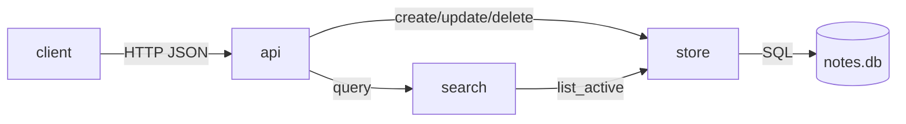

# Архітектура notes-app

## Компоненти

- **store** (`src/notes/store.py`) — єдине місце, що пише в базу. Перевіряє ліміти й нормалізує теги.
- **search** (`src/notes/search.py`) — читає через store, сам у базу не ходить. Ранжує результати.
- **api** (`src/notes/api.py`) — тонкий HTTP-шар: розбирає запит, викликає store або search, віддає JSON.

## Потік даних

## Інваріанти

1. Ідентифікатор нотатки — ціле, що лише зростає; повторно не використовується навіть після purge.
2. Видалення мʼяке: `deleted_at` проставляється, рядок лишається 30 днів (`RETENTION_DAYS`).
3. Пошук ніколи не повертає видалених нотаток.
4. `updated_at` змінюється лише за справжньої зміни заголовка, тексту чи тегів.
5. Усі часи — UTC, ISO 8601.

## Конкурентність

Один процес, одне зʼєднання SQLite на запит. Записи серіалізує SQLite (`BEGIN IMMEDIATE`). Для кількох
процесів потрібен інший рушій сховища — див. ADR-001.

## Чого тут немає

Автентифікації (сервіс локальний), повнотекстового індексу (пошук — лінійний, до ~10 000 нотаток),
вкладень.
